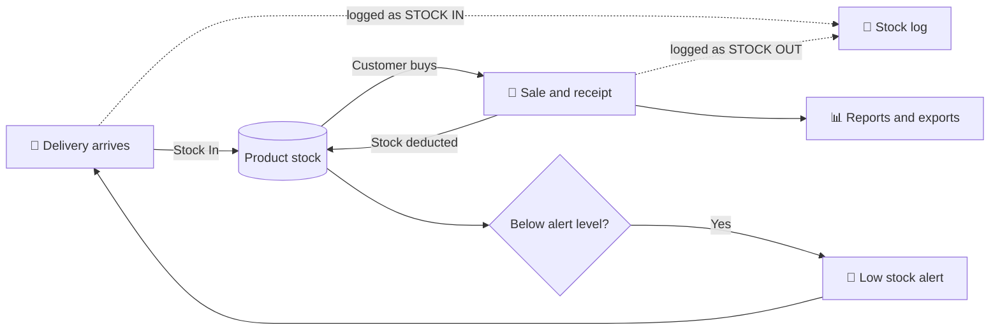
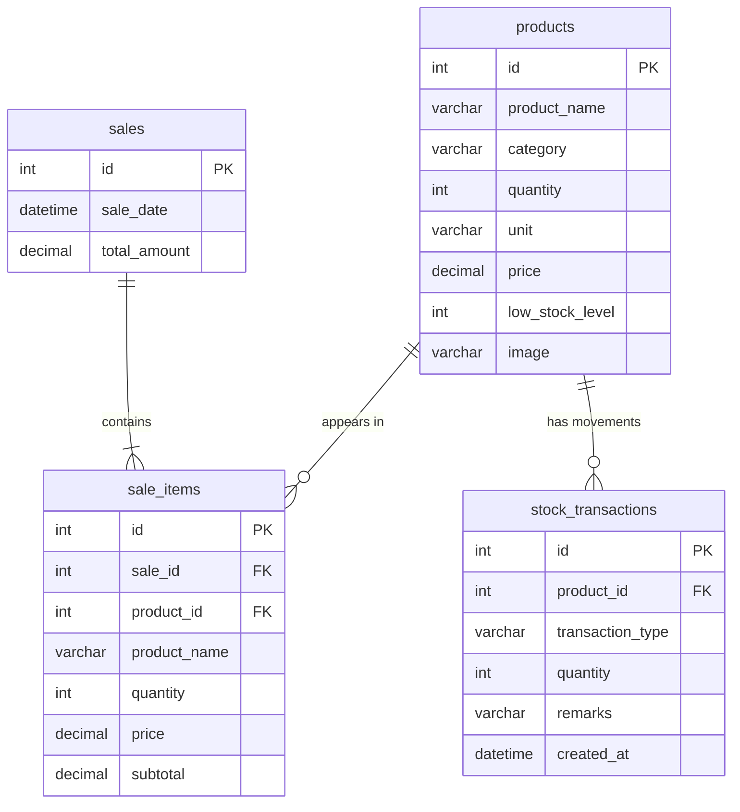

<div align="center">

# 🐔 Honey's Inventory

### Smart stock, sales, and receipt management for **Honey's Dressed Chicken and Frozen Food**

*Say goodbye to paper logbooks. Know what's in the freezer, what sold today, and what needs restocking, all in one place.*


[Features](#-features) • [How it works](#-how-it-works) • [Installation](#-installation) • [Usage guide](#-usage-guide) • [FAQ](#-faq)

</div>

---

## 📖 Table of Contents

- [About the project](#-about-the-project)
- [Features](#-features)
- [How it works](#-how-it-works)
- [A tour of the system](#-a-tour-of-the-system)
- [Tech stack](#-tech-stack)
- [Installation](#-installation)
- [Configuration](#-configuration)
- [Usage guide](#-usage-guide)
- [Database design](#-database-design)
- [Project structure](#-project-structure)
- [Security](#-security)
- [Troubleshooting](#-troubleshooting)
- [FAQ](#-faq)
- [Roadmap](#-roadmap)
- [Author](#-author)
- [License](#-license)

---

## 🍗 About the project

Running a frozen food and dressed chicken shop means juggling a lot: how many whole chickens are left, whether the nuggets ran out, what sold this week, and what to order before the weekend rush. Doing that in a notebook is slow and easy to get wrong.

**Honey's Inventory** is a complete web system built for a real local shop in **Poblacion, Inabanga, Bohol**. It keeps a live count of every product, records each sale as a proper receipt, logs every delivery, and warns the owner *before* an item runs out.

It is built with plain **PHP and MySQL**, with no heavy framework and no complicated setup. If you can run XAMPP, you can run this.

### Why you'll like it

| 🕒 Saves time | 🎯 Fewer mistakes | 💡 Better decisions |
| --- | --- | --- |
| Ring up a multi-item sale in seconds. Stock updates itself. | Every sale and delivery is logged, so counts always add up. | See best sellers, daily sales, and category trends at a glance. |

---

## ✨ Features

### 📦 Inventory management
- **Product catalog**: add, edit, and delete products with name, category, unit (`pcs`, `kg`, `pack`), price, and photo
- **Live stock levels**: quantities update automatically after every sale or delivery
- **Custom alert levels**: each product has its own low-stock threshold
- **Status badges**: every item is clearly marked **Available**, **Low stock**, or **Out of stock**
- **Stock gauges**: a visual fill bar shows how close each product is to its alert level
- **Product photos**: upload JPG, PNG, or WebP images (up to 3 MB) so items are easy to spot
- **Filter and search**: filter by status or category, or search by name from any page

### 💰 Sales and receipts
- **Multi-item receipts**: ring up several products in one sale
- **Automatic stock deduction**: stock drops the moment a sale is saved
- **Price snapshots**: each receipt keeps the product name and price from the time of sale, so old receipts never change when prices do
- **Printable receipts**: open any past receipt and print it
- **Sales history**: filter by date range and reopen any receipt

### 🚚 Stock in (deliveries)
- **Quick restock form** with quantity steppers (+ / −) and optional remarks
- **"After this delivery" preview**: see what the new stock level will be before you save
- **Automatic logging**: every delivery is recorded as `STOCK IN`

### 📊 Dashboard and reports
- **Friendly dashboard** that greets you by time of day and shows what needs attention
- **Four key numbers**: total products, units in stock, low-stock items, and sales today
- **Low stock alerts** with a direct link to restock
- **Sales this week** chart and a **recent sales** list
- **Reports**: sales by day, best sellers, and sales by category for any date range
- **Stock log**: a complete trail of every `STOCK IN` and `STOCK OUT`, so nothing disappears without a trace

### 📁 Export your data
- **CSV downloads** for products, sales, sale items, and the stock log, ready to open in Excel or Google Sheets

### 🌐 Public landing page
- **Shop website** with a product showcase and the shop address
- **Get directions** button that opens Google Maps
- **Built-in sign-in modal**, so the owner can log in right from the homepage
- **Responsive design** that works on desktop, tablet, and phone

### 🔒 Built to be safe
- Hashed admin password, auto sign-out after 30 minutes idle, and a lockout after 5 failed logins
- CSRF protection, prepared SQL statements, and safe file uploads ([details below](#-security))

### ⚡ Little touches
- Press **`/`** on any page to jump straight to the search box
- Notification bell and sidebar badge show how many products are low on stock
- Success messages fade away on their own; errors stay until you deal with them
- Peso formatting (`₱1,250.00`) and the **Asia/Manila** timezone throughout

---

## 🔄 How it works

Everything in the shop flows through three actions, and the stock log records each one.



**In plain words:** when a delivery comes in, you record it. When something sells, you create a receipt. The system does the math, updates the stock, and warns you when it's time to reorder.

---

## 🗺️ A tour of the system

| Page | What you can do there |
| --- | --- |
| 🏠 **Landing page** (`index.php`) | Public front door with the shop showcase, address, directions, and sign-in |
| 📈 **Dashboard** (`dashboard.php`) | Daily overview, low-stock alerts, weekly sales, recent sales |
| 🥩 **Products** (`products.php`) | View, search, filter, and add products with photos |
| ✏️ **Edit product** (`edit_product.php`) | Change details, replace the photo, or delete (if never sold) |
| 🚚 **Stock in** (`stock_in.php`) | Record deliveries and see the resulting stock before saving |
| 🧾 **Sales** (`sales.php`) | Create multi-item sales and receipts |
| 🕘 **Sales history** (`history.php`) | Browse past sales by date, view and print receipts |
| 📒 **Stock log** (`movements.php`) | Full history of every stock movement |
| 📊 **Reports** (`reports.php`) | Sales by day, best sellers, and sales by category |
| 📁 **Export** (`export.php`) | Download your data as CSV |

> 📸 **Screenshots:** Add images of your dashboard, products page, and receipt to a `screenshots/` folder and show them here, for example: ``

---

## 🛠️ Tech stack

| Layer | Technology |
| --- | --- |
| **Backend** | PHP 7.4+ with `mysqli` and prepared queries |
| **Database** | MySQL 5.7+ or MariaDB 10.3+ (InnoDB, foreign keys, check constraints) |
| **Frontend** | HTML5, custom CSS (`theme.css`), vanilla JavaScript |
| **Server** | Apache (XAMPP, WAMP, or LAMP) |

No Composer, no npm, and no build step.

---

## 🚀 Installation

### What you need
- [XAMPP](https://www.apachefriends.org/) (or any Apache + PHP 7.4+ + MySQL/MariaDB setup)
- A web browser

### Step by step

**1. Get the code** into your web server folder (`htdocs` for XAMPP):

```bash
git clone https://github.com/preciousmemoracion/Honeys-Inventory.git
```

**2. Start Apache and MySQL** from the XAMPP Control Panel.

**3. Create the database.** In phpMyAdmin, open the **Import** tab and import `honeys_inventory.sql`. Or use the command line:

```bash
mysql -u root < honeys_inventory.sql
```

**4. Add the product photo column.** Run this once in phpMyAdmin's **SQL** tab:

```sql
USE honeys_inventory;
ALTER TABLE products ADD COLUMN image VARCHAR(255) NULL;
```

**5. (Optional) Load sample products** to try the system right away. Import `honeys_sample_data.sql`. It adds six items: whole dressed chicken, chicken breast, chicken wings, hotdog, chicken nuggets, and pork longganisa.

**6. Check your database settings** in `db.php`:

```php
$host     = "localhost";
$user     = "root";
$password = "";
$database = "honeys_inventory";
```

**7. Open it in your browser:**

```
http://localhost/Honeys-Inventory/
```

**8. Sign in** with the username `admin` and the password set by the shop owner.

---

## ⚙️ Configuration

### 🔑 Change the admin password

The admin account isn't stored in the database. The username and password hash are defined in **both `login.php` and `index.php`**, so update both files. Generate a new hash:

```bash
php -r "echo password_hash('YourNewPassword', PASSWORD_DEFAULT);"
```

Then paste the result into `login.php` and `index.php`:

```php
const ADMIN_USERNAME      = 'admin';
const ADMIN_PASSWORD_HASH = 'paste-your-new-hash-here';
```

### 📞 Show your contact details

Near the top of `index.php`. Leave a value empty to hide it from the landing page:

```php
const CONTACT_PHONE = '0912 345 6789';
const CONTACT_EMAIL = 'honeys@example.com';
const CONTACT_HOURS = 'Mon to Sat, 7:00 AM to 6:00 PM';
const SHOP_ADDRESS  = 'Poblacion, Inabanga, Bohol';
```

### 🖼️ Landing page photos

Drop your showcase photos into `images/img/`.

### 🛡️ Login limits and timeout

| Setting | File | Default |
| --- | --- | --- |
| Failed attempts before lockout | `login.php` and `index.php` (`MAX_FAILED_ATTEMPTS`) | 5 |
| Lockout length | `login.php` and `index.php` (`LOCKOUT_SECONDS`) | 60 seconds |
| Idle sign-out | `auth.php` (`IDLE_TIMEOUT_SECONDS`) | 1800 seconds (30 min) |

---

## 📘 Usage guide

### A typical day at the shop

**🌅 Morning: check the dashboard.** Sign in and look at the low-stock alerts. Anything flagged needs attention today.

**🚚 A delivery arrives.** Go to **Stock in**, pick the product, enter the quantity received, add a remark such as the supplier's name, and check the "After this delivery" preview. Save, and the stock and log update.

**🧾 A customer buys.** Go to **Sales**, add each product and quantity, and save. The receipt is created, stock is deducted, and the sale appears on the dashboard instantly.

**🖨️ Customer wants a receipt copy.** Open **Sales history**, pick the date, open the receipt, and click **Print receipt**.

**🌙 End of day or week.** Open **Reports** to see sales by day, best sellers, and category totals. Need it in Excel? Export a CSV.

### Adding a new product
1. Go to **Products** and open the add-product panel
2. Enter the name, category, unit, price, starting quantity, and low-stock level
3. Optionally upload a photo (JPG, PNG, or WebP, under 3 MB)
4. Save

### Handy shortcuts

| Shortcut | Action |
| --- | --- |
| `/` | Jump to the search box |
| 🔔 Bell icon | See products that are low on stock |

---

## 🗄️ Database design

Four tables keep everything consistent.



**Good to know**
- `sale_items` copies the product name and price at the time of sale, so receipts stay accurate forever
- A product that appears on a receipt **cannot be deleted** (`ON DELETE RESTRICT`)
- Deleting a sale removes its line items (`ON DELETE CASCADE`)
- Quantities and prices can never go negative (`CHECK` constraints)
- `transaction_type` is always either `STOCK IN` or `STOCK OUT`

---

## 📂 Project structure

```
Honeys-Inventory/
├── 🌐 Pages
│   ├── index.php               Landing page and sign-in modal
│   ├── login.php               Admin sign-in
│   ├── logout.php              Ends the session
│   ├── dashboard.php           Overview and alerts
│   ├── products.php            Product list and add form
│   ├── edit_product.php        Edit or delete a product
│   ├── stock_in.php            Record deliveries
│   ├── sales.php               Create sales and receipts
│   ├── history.php             Sales history and receipt view
│   ├── movements.php           Stock log
│   ├── reports.php             Sales reports
│   └── export.php              CSV downloads
│
├── ⚙️ Backend helpers
│   ├── db.php                  Database connection and formatting
│   ├── auth.php                Sessions, timeout, CSRF
│   ├── helpers.php             Shared queries and stock status logic
│   ├── save_products.php       Saves new products
│   ├── product_image.php       Photo upload helpers
│   └── set_product_image.php   Photo upload endpoint
│
├── 🎨 Frontend
│   ├── nav.php                 Sidebar and top bar
│   ├── theme.css               Site styles
│   ├── app.js                  Small shared behaviours
│   └── favicon.svg             Site icon
│
├── 🗄️ Database
│   ├── honeys_inventory.sql    Schema
│   └── honeys_sample_data.sql  Optional sample products
│
└── 🖼️ Media
    ├── images/img/             Landing page photos
    └── uploads/products/       Uploaded product photos
```

---

## 🔐 Security

Small shop, serious habits:

- ✅ **Hashed password** using PHP's `password_hash` and `password_verify`
- ✅ **Session protection**: `HttpOnly` and `SameSite=Lax` cookies, plus the `Secure` flag on HTTPS
- ✅ **Auto sign-out** after 30 minutes of inactivity
- ✅ **Brute-force lockout** after 5 failed attempts
- ✅ **CSRF tokens** on forms
- ✅ **Prepared statements** for queries that use user input
- ✅ **Output escaping** to prevent XSS
- ✅ **Safe uploads**: type and size checks, and PHP execution is blocked in `uploads/products/`
- ✅ **Redirect safety**: sign-in only redirects to local pages

> ⚠️ **Before going live on the internet:** change the default admin password, set a password for the MySQL `root` user (or create a dedicated database user and update `db.php`), and serve the site over **HTTPS**.

---

## 🧰 Troubleshooting

| Problem | Likely cause and fix |
| --- | --- |
| **"Database connection failed"** | MySQL isn't running, or the details in `db.php` don't match. Start MySQL and check the host, user, password, and database name. |
| **"Unknown column 'image'"** | You skipped step 4. Run the `ALTER TABLE products ADD COLUMN image ...` command from the installation section. |
| **Tables not found** | The schema wasn't imported. Import `honeys_inventory.sql` first. |
| **Photos won't upload** | Check the file is JPG, PNG, or WebP and under 3 MB, and that `uploads/products/` is writable by the web server. |
| **Can't sign in** | After 5 wrong attempts you're locked out for a minute. Wait and try again, or generate a new password hash. |
| **Signed out unexpectedly** | The session expires after 30 minutes of inactivity. Just sign in again. |
| **Blank page or broken downloads** | Stray output (extra spaces or lines) before `<?php` in a PHP file can break redirects and downloads. Make sure no file has content before the opening tag. |

---

## ❓ FAQ

**Can more than one person log in?**
Right now there is one admin account. Multiple accounts with roles are on the roadmap.

**What happens to old receipts if I change a product's price?**
Nothing. Each receipt keeps the name and price from the moment of sale.

**Why can't I delete a product?**
It has already been sold, and deleting it would break your sales history. Edit it instead, or set its quantity to zero.

**Can I use this for a different kind of shop?**
Yes. Change the shop name, address, and products, and it works for any small retail business.

**Does it work on a phone?**
Yes. The layout is responsive and includes a collapsible menu for small screens.

**Can I get my data into Excel?**
Yes. Use the CSV exports for products, sales, sale items, and the stock log.

---

## 🗺️ Roadmap

- [ ] Multiple user accounts with owner and staff roles
- [ ] Supplier tracking and purchase records
- [ ] Expiry date tracking for frozen goods
- [ ] PDF reports and downloadable receipts
- [ ] Customer records and credit (utang) tracking
- [ ] Dashboard charts for monthly and yearly trends

Have an idea? Open an issue and share it.

---

## 🤝 Contributing

Contributions, bug reports, and ideas are welcome.

1. Fork the repository
2. Create your branch: `git checkout -b feature/your-idea`
3. Commit your changes: `git commit -m "Add your idea"`
4. Push to the branch: `git push origin feature/your-idea`
5. Open a Pull Request

---

## 👩‍💻 Author

**Precious Memoracion**
GitHub: [@preciousmemoracion](https://github.com/preciousmemoracion)

Built for **Honey's Dressed Chicken and Frozen Food**, Poblacion, Inabanga, Bohol 🇵🇭

---

## 📄 License

No license has been specified yet. Add a `LICENSE` file (for example MIT) if you'd like others to be able to use and build on this project.

---

<div align="center">

⭐ **If you find this project useful, give it a star!** ⭐

*Made with care for small businesses.*

</div>
